

  

  

  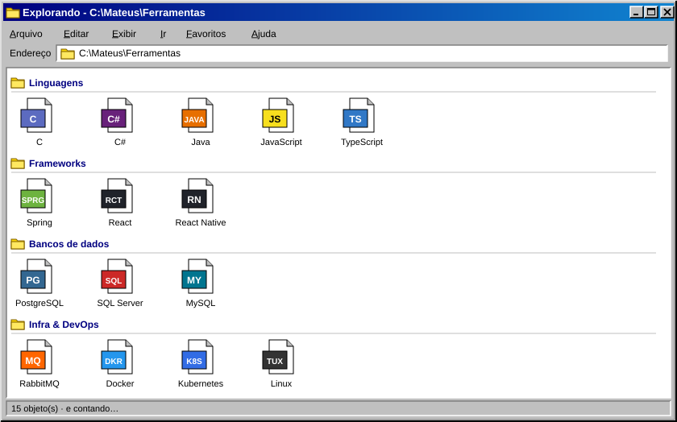

  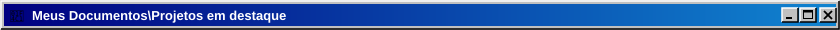

  <a href="https://github.com/mateuszebendo/iceberg">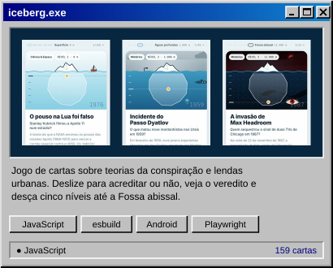</a>
  <a href="https://github.com/mateuszebendo/portifolio-win98">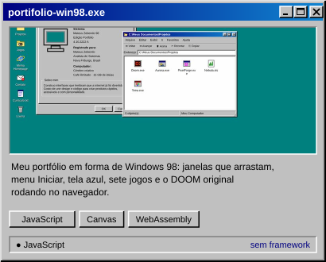</a>

  <a href="https://github.com/mateuszebendo/lousa-viva">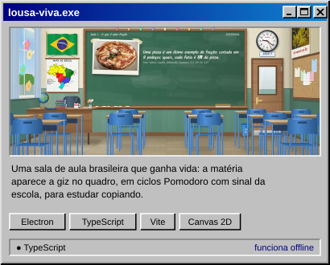</a>
  <a href="https://github.com/LucasLira11/repoguard-nudge">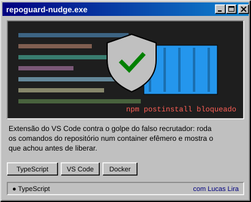</a>

  <a href="https://github.com/mateuszebendo/sensei-try-catch">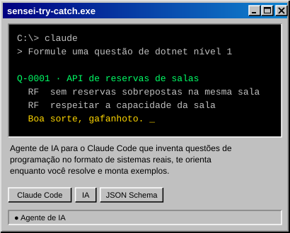</a>
  <a href="https://github.com/mateuszebendo/luckiest-gamble">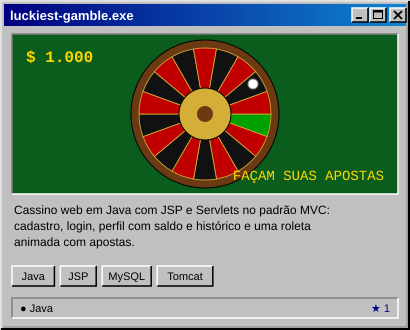</a>

  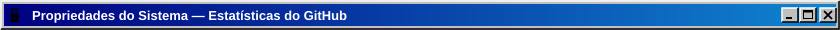

  
  

  

